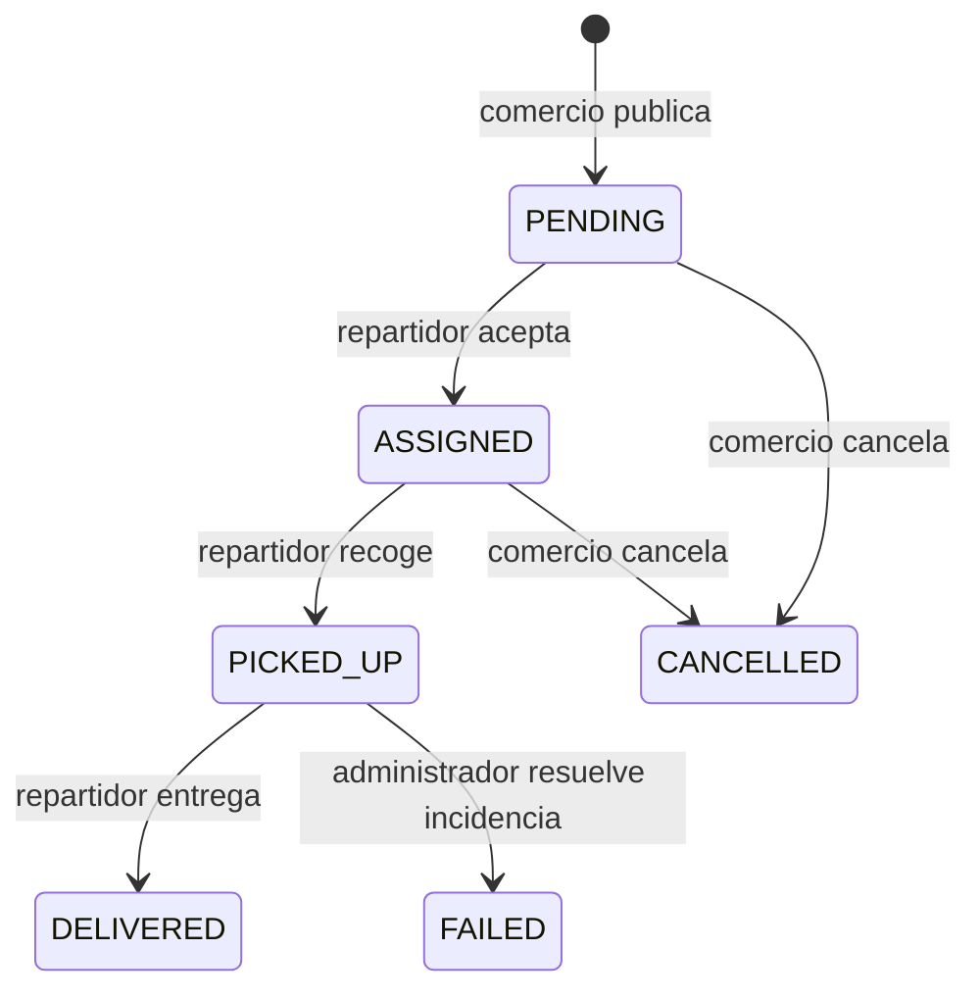
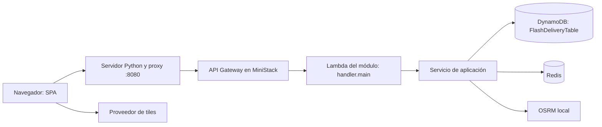

# FlashDelivery — Arquitectura y guía de estudio

**Versión documental:** 2.0 · **Fecha de revisión:** 2026-11-18. Describe la implementación de SPEC-00 a SPEC-10, fusionada en `develop` hasta `5f85467`. SPEC-11 actualiza documentación; no añade comportamiento de negocio.

Este documento explica qué hace el sistema, cómo está construido y por qué se eligió cada estructura de datos. El [modelo físico](data-model/README.md) fija los atributos; la [matriz de acceso](data-access-patterns.md) conecta necesidades con consultas; [OpenAPI](api/openapi.json) fija los contratos HTTP. Los resultados de pruebas están en [validación](validation.md), con fecha y alcance.

## Ruta de lectura

1. Secciones 1–3: negocio, componentes y vocabulario.
2. Secciones 4–8: diseño de tabla única, claves e índices; seguir el pedido de ejemplo con lápiz y papel.
3. Secciones 9–12: transacciones, carreras, reintentos y Redis.
4. Secciones 13–17: geografía, permisos, API, ejecución y pruebas.
5. Secciones 18–20: decisiones, límites, preguntas de repaso y fuentes.

Los identificadores `S01`, `R01`, `O01` y las fechas de ejemplos son sintéticos. No son cuentas ni credenciales del entorno. Las expresiones SQL son comparaciones didácticas, no consultas ejecutadas por la aplicación.

## 1. Qué problema resuelve

Un comercio habilitado publica una solicitud de entrega en su zona. Los repartidores habilitados y disponibles de esa zona ven solicitudes pendientes y compiten por aceptarlas. Solo uno obtiene la asignación; cada repartidor puede tener una sola entrega activa. El comercio observa el avance y comparte con el destinatario un enlace de seguimiento. El administrador revisa perfiles y resuelve ciertas incidencias.

| Actor | Operaciones implementadas | Restricción relevante |
| --- | --- | --- |
| STORE | Registrarse, crear/listar/consultar pedidos propios, cancelar antes de recogida, consultar estadísticas/presencia, consultar ubicación/ruta de sus entregas | Su identidad determina storeId; debe estar habilitado para publicar |
| COURIER | Registrarse, declarar disponibilidad, renovar presencia, listar ofertas de su zona, aceptar, recoger, entregar, consultar historial y compartir ubicación | Habilitado/disponible para aceptar; solo una entrega activa |
| ADMIN | Listar/revisar/habilitar/suspender/reactivar perfiles, consultar auditoría y pedidos, marcar FAILED | Suspensión de repartidor bloqueada con ACTIVE; no obtiene permiso geográfico |
| Destinatario | Consultar estado y, si corresponde, ubicación/ruta mediante token | Respuesta pública limitada; geografía exige credencial vigente y entrega activa |

### Estados del pedido



Los estados terminales son DELIVERED, CANCELLED y FAILED. Llegar al final de una ruta simulada no modifica el estado: recoger y entregar requieren sus comandos explícitos. No hay reasignación, regreso a PENDING ni varias entregas simultáneas para el mismo repartidor.

Los perfiles tienen otro ciclo, independiente: PENDING, ENABLED y SUSPENDED. Su booleano `enabled` concede el permiso efectivo; el estado del perfil nunca sustituye al estado del pedido.

## 2. Arquitectura ejecutable

El proyecto es un **monolito modular con entrada serverless**: comparte código, esquema e infraestructura de persistencia, y despliega una Lambda por módulo HTTP. No es un conjunto de microservicios con bases independientes. Los servicios Python colaboran dentro del mismo proceso cuando un caso de uso lo requiere; no se invocan entre sí mediante llamadas Lambda-a-Lambda.



El navegador renderiza el mapa con MapLibre. OSRM calcula recorridos desde el backend; no entrega imágenes del mapa. Los tiles tienen su propio proveedor. Separar esos tres componentes ayuda a diagnosticar si falla el fondo del mapa, la geometría vial o la publicación de la posición.

### Qué aporta cada capa

| Capa | Ubicación | Responsabilidad real |
| --- | --- | --- |
| Infraestructura | `app/infra/stack.py`, `routes.py` | CDK, tabla/GSIs, Lambdas, roles y rutas |
| Entrada HTTP | `app/lambdas/<módulo>/handler.py` | Adaptar solicitud, contexto autenticado y resultado al HTTP |
| Aplicación | `service.py` y auxiliares del módulo | Reglas, permisos, coordinación y transacciones |
| Persistencia | `repository.py`, `shared/storage/` | Claves, lecturas, validación y acciones DynamoDB |
| Adaptadores | `shared/infrastructure/`, Tracking | SDK, Redis, proveedor OSRM; inyectables en pruebas |
| Frontend | `frontend/app.js`, `src/` | Vistas funcionales, shell React, mapas, bandejas, intenciones de reintento |

La separación es pragmática. Solo Identity publica un `contracts.py`; existen importaciones directas de repositorios entre módulos y servicios de Orders usados por Dispatch. No se debe estudiar el antiguo diseño de protocolos universales como si ya estuviera implementado. Los [contratos actuales](module-contracts.md) explican las dependencias existentes y sus límites.

Compartir una tabla simplifica las proyecciones y su coordinación, pero **DynamoDB también admite transacciones sobre varias tablas**. La atomicidad no depende de elegir single table; aquí la elección responde al modelo de acceso y al alcance académico. [Referencia de transacciones](https://docs.aws.amazon.com/amazondynamodb/latest/APIReference/API_TransactWriteItems.html).

## 3. Vocabulario: primary key, partition key y sort key

En esta tabla, la **primary key o clave primaria es compuesta: `(PK, SK)`**. `PK` es el nombre del atributo usado como **partition key**; `SK` es el nombre del atributo usado como **sort key**. Un ítem queda identificado por los dos valores juntos. PK por sí sola puede repetirse.

| Concepto | Significado | Ejemplo del proyecto |
| --- | --- | --- |
| Tabla | Colección de ítems de distintos tipos | FlashDeliveryTable |
| Ítem | Un registro con atributos y clave primaria | El perfil del comercio S01 |
| Atributo | Campo de ese registro | name, enabled, status, PK |
| Partition key | Componente que agrupa ítems y participa en la distribución | `ORDER#O01` |
| Sort key | Componente que distingue y ordena ítems de una misma PK | `META` o `EVENT#fecha#id` |
| Primary key | Identificador único completo en la tabla | `ORDER#O01 / META` |
| Colección de ítems | Ítems con el mismo valor de PK | META, TRACKING y eventos de O01 |
| GSI | Índice con claves alternativas para otra consulta | GSI1 por comercio y fecha |
| Proyección de aplicación | Ítem adicional escrito por nuestro código | STORE_STATUS_VIEW |
| Proyección del índice | Atributos que DynamoDB replica al GSI | ALL en GSI1 y GSI2 |

AWS define la clave primaria simple o compuesta y los componentes de la tabla en su [guía de componentes](https://docs.aws.amazon.com/amazondynamodb/latest/developerguide/HowItWorks.CoreComponents.html).

**Una PK lógica no equivale a una partición física reservada exclusivamente para ella.** DynamoDB administra la distribución física. Los prefijos `STORE#`, `COURIER#` y `ORDER#` son convenciones de esta aplicación, no instrucciones especiales del motor. `#` separa segmentos para que sean legibles e inequívocos. [Distribución de datos](https://docs.aws.amazon.com/amazondynamodb/latest/developerguide/HowItWorks.Partitions.html).

Tampoco son claves foráneas SQL: guardar `storeId=S01` en un pedido no crea una restricción referencial automática. La aplicación comprueba el perfil y las condiciones necesarias cuando escribe.

### Tres lecturas distintas

- **GetItem:** conocemos PK y SK completas. Ejemplo: buscar `ORDER#O01 / META`.
- **Query:** fijamos el valor de partition key y, si hace falta, restringimos sort key con prefijo o rango. Ejemplo: `PK=ORDER#O01`, `SK begins_with EVENT#`.
- **Scan:** recorre ítems sin un acceso de clave dirigido. No se usa para endpoints de negocio. Existe en mantenimiento explícito y en el benchmark comparativo.

No se puede hacer una Query eficiente por cualquier atributo arbitrario ni consultar globalmente por una SK aislada. Diseñar una clave empieza por saber qué valores tendrá disponibles el caso de uso. [Condiciones de Query](https://docs.aws.amazon.com/amazondynamodb/latest/developerguide/Query.KeyConditionExpressions.html).

## 4. Cómo se decidió el diseño single table

El punto de partida fueron las preguntas del negocio: perfil por ID, pedido por ID, eventos de una entrega, historial por comercio/repartidor, ofertas por zona y estado, entrega activa, estadística mensual y, después, bandejas administrativas.

En un modelo relacional podríamos normalizar Comercios, Repartidores, Pedidos, Eventos y Asignaciones y resolver combinaciones con joins. Aquí se construyen rutas de acceso explícitas mediante claves e ítems derivados. No es una afirmación de superioridad general sobre SQL: cambia qué trabajo se realiza al escribir y qué consultas quedan preparadas.

El procedimiento aplicado es:

1. Anotar la pregunta y quién puede hacerla.
2. Identificar el dato conocido al consultar: storeId, courierId, orderId, zoneId, mes o estado.
3. Elegir GetItem si conocemos una clave única, o Query si necesitamos una colección ordenada.
4. Definir PK para el grupo y SK para el tipo/orden/rango.
5. Si la tabla base no sirve para otra pregunta, reutilizar un GSI o crear un ítem de lectura derivado.
6. Definir qué escrituras deben mantener juntos los registros y qué lectura tolera retraso.
7. Verificar con pruebas las invariantes, las páginas y las carreras.

Este enfoque de comenzar por preguntas está documentado en [modelado NoSQL de AWS](https://docs.aws.amazon.com/amazondynamodb/latest/developerguide/bp-modeling-nosql.html). Nuestro conjunto concreto de consultas está en [AP01–AP16](data-access-patterns.md); añadir una pantalla con otra consulta exige revisar ese conjunto.

## 5. Por qué estas PK y estas SK

La tabla tiene dos atributos String para su clave primaria y dos GSIs. Los campos `entityType`, `schemaVersion` y `version` permiten validar registros heterogéneos y controlar cambios. Los formatos canónicos se calculan en `shared/storage/keys.py` y `model.py`; el llamador no decide índices arbitrarios.

### 5.1 Comercio: `STORE#S01`

```text
PK=STORE#S01
  SK=PROFILE          → perfil: nombre, zona, enabled, approvalStatus
  SK=STATUS#O01       → vista del estado de O01 para este comercio
  SK=STATUS#O02       → vista del estado de O02 para este comercio
  SK=STATS#2026-11    → entregas e importe acumulado del mes
```

Agrupa registros que se consultan desde la identidad del comercio. `PROFILE` es una clave fija porque hay un perfil por comercio. `STATS#YYYY-MM` permite leer un mes por clave exacta. `STATUS#orderId` da una ubicación estable a la vista del pedido aunque su estado cambie.

**Por qué STATUS no contiene el estado en la SK base:** si usáramos `STATUS#PENDING#O01`, cambiar a ASSIGNED obligaría a borrar una clave y crear otra. Con `STATUS#O01`, se sustituye el mismo ítem; el estado variable vive en su GSI2PK. El historial completo del comercio usa otro camino: GSI1 sobre el META del pedido.

### 5.2 Repartidor: `COURIER#R01`

```text
PK=COURIER#R01
  SK=PROFILE       → habilitación, zona y disponibilidad declarada
  SK=ACTIVE        → orderId de la única entrega activa
  SK=ORDER#O01     → vista del historial de O01
```

`ACTIVE` es una **clave fija de exclusión**. Cada intento de aceptación trata de crear exactamente la misma clave para ese repartidor con condición de ausencia. Si dos pedidos distintos compiten por R01, solo uno puede crearla. Usar `ACTIVE#O01` permitiría varias claves y perdería esa garantía.

El historial `ORDER#O01` permanece después de entregar; ACTIVE se elimina. Esto separa «trabaja ahora» de «trabajó antes» y permite consultar el activo con GetItem fuerte, sin recorrer pedidos ni depender de un índice eventual.

### 5.3 Pedido: `ORDER#O01`

```text
PK=ORDER#O01
  SK=META                                      → estado oficial y datos del pedido
  SK=TRACKING                                  → nonce, expiresAt, revoked
  SK=EVENT#2026-11-18T15:00:00.000000Z#e_01      → CREATED
  SK=EVENT#2026-11-18T15:01:00.000000Z#e_02      → ASSIGNED
```

El identificador de pedido permite llegar al estado oficial sin conocer comercio ni repartidor. `META` es único y fijo: las transiciones siempre compiten sobre el mismo registro. Los eventos son ítems separados para que el historial crezca sin ampliar una lista dentro de META.

La SK de evento comienza por su tipo de acceso, después fecha y finalmente ID. El prefijo permite consultar solo eventos. Fechas UTC con seis decimales ordenan cronológicamente como cadenas. El ID desempata eventos del mismo instante; ese desempate no pretende demostrar causalidad entre relojes distintos.

`TRACKING` separa la credencial pública del estado/versiones del pedido: revocar el enlace cambia ese ítem, sin incrementar las versiones de META ni de sus vistas. La fecha de expiración se valida en aplicación; no hay TTL DynamoDB configurado para borrarlo automáticamente.

### 5.4 Idempotencia: `REQUEST#scope#requestId / IDEMPOTENCY`

Ejemplo completo: `REQUEST#S01:orders.create.v1#pedido-1 / IDEMPOTENCY`.

El scope incluye actor y operación versionada; por eso `pedido-1` puede usarse en otra operación o por otro actor sin colisionar. La PK incorpora también la intención concreta y se recupera por GetItem. El atributo `payloadHash` compara el contenido, mientras `result` conserva el resultado técnico necesario para recuperar la operación.

No se usa un único documento con una lista de todas las intenciones de un usuario: cada intención es un ítem independiente. Tampoco se confunde requestId de trazabilidad HTTP con Idempotency-Key; tienen propósitos diferentes. No hay TTL de idempotencia establecido en esta entrega.

### 5.5 Auditoría de perfil: `PROFILE_AUDIT#STORE#S01`

La SK es `EVENT#fecha#eventId`. El tipo STORE o COURIER evita colisiones si ambos perfiles usan el mismo ID. Cada cambio contiene administrador, estado anterior/nuevo, motivo y `profileVersion`. La partición separa estas decisiones de los eventos de pedidos y permite consultar el historial de un perfil por Query fuerte.

No se guarda bajo `ADMIN#actorId`: la pregunta implementada es «¿qué decisiones se tomaron sobre este perfil?». Un informe «todas las decisiones de un administrador» requeriría otro patrón de acceso. No existe actualmente un índice para esa pregunta.

## 6. Por qué existen GSI1 y GSI2

Un índice cambia la manera de agrupar/ordenar ítems. No cambia la clave primaria de la tabla base. Cada GSI usa un par de atributos diferente y proyección ALL. Aquí ambos son **dispersos**: los ítems sin las claves correspondientes quedan fuera. Las copias del índice las mantiene DynamoDB; los ítems STORE_STATUS_VIEW y COURIER_ORDER_VIEW los mantiene el código. [Funcionamiento de GSIs](https://docs.aws.amazon.com/amazondynamodb/latest/developerguide/GSI.html).

### 6.1 GSI1: historiales ordenados por creación

| Ítem que aporta la entrada | GSI1PK | GSI1SK | Pregunta |
| --- | --- | --- | --- |
| ORDER/META | `STORE#S01` | `ORDER#createdAt#O01` | ¿Cuáles son los pedidos de S01 por fecha? |
| COURIER_ORDER_VIEW | `COURIER#R01` | `ORDER#createdAt#O01` | ¿Qué pedidos tiene R01 en su historial? |

Dos necesidades comparten un índice físico mediante prefijos distintos: es sobrecarga de índice. El historial del repartidor se ordena por **creación del pedido**, no por aceptación. `createdAt` permanece estable durante sus transiciones.

**Por qué otra vista para el repartidor:** el META ya usa GSI1 para el comercio. No puede poner simultáneamente dos valores diferentes en GSI1PK para ese mismo ítem. La vista adicional aporta una segunda entrada desde un ítem propio. La tabla base localiza esa vista por `COURIER#R01 / ORDER#O01`, y GSI1 la ordena por fecha.

### 6.2 GSI2: subconjuntos operativos

| Ítem | GSI2PK | GSI2SK | Necesidad |
| --- | --- | --- | --- |
| ORDER/META solo PENDING | `ZONE#centro#OPEN` | `CREATED#createdAt#O01` | Ofertas abiertas de una zona |
| STORE_STATUS_VIEW | `STORE#S01#ASSIGNED` | `CREATED#createdAt#O01` | Pedidos del comercio en cierto estado |
| STORE PROFILE | `ADMIN#STORE#PENDING` | `CREATED#createdAt#S01` | Solicitudes de comercios pendientes |
| COURIER PROFILE | `ADMIN#COURIER#SUSPENDED` | `CREATED#createdAt#R01` | Repartidores suspendidos |

`OPEN` es un segmento de la clave del índice; el nombre del estado de negocio es **PENDING**. No hay estado OPEN en la máquina implementada.

**Por qué se retira del índice al aceptar:** al salir de PENDING, la sustitución de META omite GSI2PK/GSI2SK. El motor elimina su entrada de ofertas cuando converge el índice. Guardar esos atributos como null sería incorrecto para este esquema. La vista del comercio conserva su propio GSI2 con el nuevo estado; ambos ítems son independientes.

**Por qué una vista de estado del comercio:** META usa su GSI2 para la zona mientras está pendiente. Un segundo ítem permite a la vez consultar pendientes del comercio sin colisionar con ese acceso por zona. No se intenta resolverlo filtrando todas las ofertas de la zona por storeId.

**Por qué estado en la partition key administrativa:** el administrador pregunta por tipo y estado, ambos conocidos. Así consulta un grupo dirigido. La contrapartida es concentrar perfiles en pocos grupos, un riesgo de tráfico caliente si la aplicación creciera; no hay sharding implementado.

### 6.3 Costes y límites de esta elección

Se ahorran recorridos generales a cambio de escrituras adicionales, almacenamiento de vistas y copias en los GSIs. ALL simplifica la recuperación de atributos pero replica más datos de los que necesita cada DTO. Las claves GSI no son únicas: dos entradas pueden compartir valores; la identidad real sigue siendo PK/SK de la tabla base.

Dos índices bastan para las consultas actuales. No significan «cualquier consulta futura gratis». Buscar comercios por texto, filtrar arbitrariamente tarifas o consultar auditoría global requeriría diseño y medición adicionales.

## 7. Un pedido completo, registro por registro

Supongamos S01 habilitado en centro, R01 habilitado y disponible, y creación de O01 a las `2026-11-18T15:00:00.000000Z`.

### Al publicar

El caso de uso verifica el perfil del comercio y confirma juntos META PENDING, TRACKING, evento CREATED, vista STATUS del comercio y resultado idempotente. También incluye una condición sobre versión/habilitación del perfil.

| PK / SK | Contenido o índice relevante |
| --- | --- |
| `ORDER#O01 / META` | status=PENDING, version=1; GSI1 del comercio y GSI2 de abiertos |
| `ORDER#O01 / TRACKING` | nonce, expiración y revocación; sin GSI |
| `ORDER#O01 / EVENT#fecha#e_01` | eventType=CREATED |
| `STORE#S01 / STATUS#O01` | status=PENDING, version=1; GSI2 por estado del comercio |
| `REQUEST#S01:orders.create.v1#pedido-1 / IDEMPOTENCY` | Huella de entrada y orderId confirmado |

### Al aceptar R01

META y la vista STATUS pasan a ASSIGNED/version 2; se escribe evento ASSIGNED; se crean `COURIER#R01 / ACTIVE` y `COURIER#R01 / ORDER#O01`. Se confirma la condición de elegibilidad del perfil y el resultado idempotente del accept. META sale de abiertos; la vista STATUS cambia su GSI2 a `STORE#S01#ASSIGNED`.

### Al recoger

META y ambas vistas del pedido pasan a PICKED_UP/version 3. Se añade su evento y registro idempotente. ACTIVE permanece. La ruta de recogida deja de ser la ruta de la nueva fase.

### Al entregar

META y ambas vistas pasan a DELIVERED/version 4. Se añade evento, se elimina ACTIVE solo si apunta a O01, se incrementa `STORE#S01 / STATS#2026-11` y se registra la intención idempotente. El historial del repartidor permanece; se libera su posibilidad de aceptar otro pedido. La posición/ruta activa se limpia después y se oculta por estado terminal aunque falle esa limpieza.

El `version` de un evento independiente puede ser 1: no es la versión del pedido. Las vistas del pedido sí replican su versión. En auditoría administrativa, `profileVersion` señala la versión del perfil; `version` sigue perteneciendo al propio ítem de auditoría.

## 8. Cómo leer sin Scan

Ejemplos conceptuales de expresiones, con valores inventados:

```text
Detalle:
  GetItem Key={PK: ORDER#O01, SK: META}, ConsistentRead=true

Eventos:
  Query base: PK = ORDER#O01 AND begins_with(SK, EVENT#)

Historial del comercio:
  Query GSI1: GSI1PK = STORE#S01 AND begins_with(GSI1SK, ORDER#)
  ScanIndexForward=false

Pendientes de la zona:
  Query GSI2: GSI2PK = ZONE#centro#OPEN AND begins_with(GSI2SK, CREATED#)

Pedidos asignados del comercio:
  Query GSI2: GSI2PK = STORE#S01#ASSIGNED AND begins_with(GSI2SK, CREATED#)
```

El repositorio real usa alias (`#pk`, `#sk`, etc.) y serialización DynamoDB para las expresiones. No se interpolan entradas del usuario en texto de consultas.

### Orden, rango y paginación

La fecha canónica se normaliza a UTC con seis decimales. Mezclar zonas horarias o anchos distintos rompería la equivalencia entre orden léxico y cronológico. Un rango por fechas se convierte en límites de sort key; su extremo superior contempla los IDs que desempatan ese instante.

Los listados usan `limit` entre 1 y 100. El cursor codifica LastEvaluatedKey y una huella de consulta que incluye partición, prefijo, índice, dirección y rango. Cambiar de estado o actor cambia el ámbito esperado; usar el cursor equivocado se rechaza. Se puede cambiar el tamaño de página.

No es un cursor firmado ni un permiso de acceso: la identidad decide la consulta en cada solicitud. `nextCursor=null` indica final; una página vacía puede tener cursor. Las inserciones concurrentes no congelan el conjunto entre páginas.

Una Query tiene límite de página de 1 MB. `FilterExpression` actúa después de leer y no evita el trabajo de lectura. Por eso diseñar GSI2 por estado es distinto de traer todo y filtrarlo. [Filtro y límite](https://docs.aws.amazon.com/amazondynamodb/latest/developerguide/Query.FilterExpression.html).

## 9. Consistencia y transacciones

Las lecturas base de los repositorios usan consistencia fuerte; los GSIs son eventualmente consistentes. El índice puede mostrar una oferta que acaba de ser aceptada o tardar en mostrar un perfil nuevo. No se concede una asignación basándose solo en una lista. Las condiciones del commit comprueban el estado oficial. [Consistencia DynamoDB](https://docs.aws.amazon.com/amazondynamodb/latest/developerguide/HowItWorks.ReadConsistency.html).

Una lectura fuerte tampoco bloquea el ítem frente a la siguiente solicitud. Existe tiempo entre leer y escribir. El **bloqueo optimista** usa `version`: si se leyó 7, la escritura exige que siga en 7 y sustituye por 8. Si otro proceso cambió el registro, se rechaza.

La implementación utiliza normalmente **Put condicional de un ítem completo**, no Update parcial para cada transición. `build_transition` reconstruye META y vistas. Eso también retira claves GSI que ya no corresponden. El agregado mensual sí usa Update con ADD; las piezas se componen en un TransactWriteItems común.

| Operación | Efectos atómicos relevantes |
| --- | --- |
| Crear | Condición comercio + META + TRACKING + CREATED + vista comercio + idempotencia |
| Aceptar | META/vista comercio/evento + condición repartidor + ACTIVE + vista repartidor + idempotencia |
| Recoger | META + dos vistas + evento + idempotencia |
| Entregar | Lo anterior + liberar ACTIVE + sumar estadística mensual |
| Cancelar/fallar | Transición y evento/vistas; liberar ACTIVE si existe asignación; idempotencia |
| Aprobar/suspender | Perfil + PROFILE_AUDIT; suspensión de repartidor añade ausencia de ACTIVE |

El motor acepta hasta 100 acciones distintas y 4 MB por transacción; no se pueden ejecutar dos acciones sobre el mismo ítem en una transacción. Por eso la condición del META forma parte de su Put, en vez de añadir otro ConditionCheck al mismo META. [Contrato de TransactWriteItems](https://docs.aws.amazon.com/amazondynamodb/latest/APIReference/API_TransactWriteItems.html).

## 10. Tres carreras que justifican las claves

### Dos repartidores quieren O01

Ambos pueden leer PENDING/version 1. Ambos intentan reemplazar el mismo `ORDER#O01 / META` condicionado a version 1. Solo uno confirma y el otro obtiene conflicto. El perdedor no deja ACTIVE, evento ni vistas parciales porque se descarta toda su transacción.

### R01 quiere O01 y O02 a la vez

Los META son distintos y su versión no basta para impedirlo. La protección común es `COURIER#R01 / ACTIVE`: ambos commits necesitan crearla si no existe. Uno gana. Esta regla explica por qué ACTIVE se agrupa por repartidor y tiene SK fija.

### Un administrador suspende R01 mientras acepta

Aceptar exige versión/habilitación/disponibilidad del perfil y crea ACTIVE. Suspender cambia el perfil y exige que ACTIVE no exista dentro de la misma transacción. Si aceptar gana, la suspensión falla por ACTIVE. Si suspender gana, aceptar pierde la condición de perfil. No puede resultar una nueva asignación confirmada a un perfil suspendido.

Las tres propiedades tienen pruebas reales; no se deducen de un lock Redis. El lock de rutas sirve para coordinar cálculos OSRM, no para adjudicar pedidos.

## 11. Idempotencia y recuperación de errores

Un timeout del cliente no demuestra que el servidor no escribió. Si el cliente genera otra intención para reintentar, podría crear dos pedidos. Por eso envía la misma `Idempotency-Key` para la misma operación pendiente.

`run_command` calcula una huella JSON canónica de los campos de negocio y busca el registro de esa intención. Misma huella: recupera el resultado guardado. Huella diferente: 409 IDEMPOTENCY_CONFLICT. Si no existe, el resultado se confirma junto al resto de acciones. La huella no depende del requestId de trazabilidad ni de la hora generada por el servidor.

Los servicios pueden releer el pedido al construir su respuesta: un replay preserva la operación y no duplica efectos, pero no promete una copia byte a byte del JSON original si el pedido avanzó de estado. Crear recupera el mismo orderId y deriva el token a partir del nonce persistido.

La SPA conserva la clave de una intención incierta y permite recuperar esa clave tras recargar si se reenvían los mismos datos. Esto no constituye una cola duradera que reenvía solicitudes automáticamente.

No todos los PATCH usan Idempotency-Key. Perfil/disponibilidad son escrituras condicionadas o naturalmente repetibles. En aprobaciones, repetir el estado ya aplicado es no-op: no añade evento ni aumenta versión; una versión antigua que intenta otra transición devuelve 409 PROFILE_CHANGED. Ubicación tiene control temporal/secuencia propio. OpenAPI especifica cuáles comandos exigen el encabezado.

## 12. Qué guarda Redis y por qué

DynamoDB conserva pedidos, perfiles, asignación, agregados, credenciales de seguimiento y auditorías. Redis conserva datos que pueden caducar o reconstruirse y coordinación temporal.

| Clave o familia | Contenido | Política inicial |
| --- | --- | --- |
| `courier:heartbeat:R01` | Zona y última señal del servidor | TTL 60 s |
| `couriers:available:centro` | ZSET de courierId con score temporal | Retiro de vencidos y revalidación del heartbeat |
| `cache:store:S01:stats:2026-11` | Copia del agregado mensual | Cache-Aside, TTL 300 s |
| `tracking:order:O01:latest` | Última posición aceptada o marca de parada | TTL 120 s; sin histórico de movimiento |
| `tracking:order:O01:route:ASSIGNED` | Snapshot de ruta/progreso por fase | TTL 300 s |
| Locks, cooldown y contadores de Tracking | Control de recálculo, límites de frecuencia | Expiración específica; ver módulo y guía GEO |

`available=true` en el perfil expresa disposición a trabajar; el heartbeat expresa presencia reciente. Un miembro de un ZSET no expira individualmente por sí mismo. La aplicación descarta scores antiguos y comprueba la clave con TTL. **Aceptar no exige un heartbeat Redis**: exige elegibilidad y ausencia de ACTIVE en DynamoDB.

Las estadísticas oficiales son un agregado mensual actualizado en la entrega, no una suma Scan en cada consulta ni un consumidor asíncrono de eventos. Redis acelera la repetición de su lectura; se invalida después del commit. Si falla, Analytics lee DynamoDB. Una carrera de caché o una invalidación fallida puede dejar una copia temporal hasta su TTL; no se afirma consistencia fuerte de la caché.

No hay transacción distribuida DynamoDB–Redis. Que Redis falle después del commit no deshace una entrega. Presencia puede responder 503; ubicación/rutas se degradan; la consulta de estadísticas tiene fallback. Cada endpoint tiene su comportamiento, no una promesa universal de funcionamiento sin Redis.

## 13. Ubicación, recorrido y ETA

Se separan tres datos distintos:

1. **Puntos estáticos de recogida y entrega:** opcionales, ambos juntos, guardados en ORDER/META como `pickupCoordinates`/`dropoffCoordinates` con enteros E6. Por ejemplo, latitud 11.24424 equivale a `latitudeE6=11244240`. El DTO los presenta como `pickupLocation`/`dropoffLocation` en grados. No son muestras de movimiento.
2. **Última posición del repartidor:** Redis; source SIMULATED o BROWSER_GPS, tiempo y secuencia si corresponde. FRESH hasta 15 s, STALE después y UNAVAILABLE tras el límite de 120 s. No hay un historial GPS DynamoDB.
3. **Ruta calculada:** OSRM local, cacheada por fase en Redis. ASSIGNED conduce de la posición a recogida; PICKED_UP a destino. GeoJSON usa coordenadas `[longitud, latitud]`.

La publicación tiene separación mínima inicial de 3000 ms y validación de datos, estado y actor. Muestras antiguas/duplicadas no renuevan vigencia. La simulación exige configuración explícita de backend local y controles incluidos con `build:local`, además del consentimiento en UI.

El progreso se proyecta sobre la geometría vial. Tres muestras válidas fuera de ruta activan recálculo bajo umbrales de precisión y cooldown inicial de 30 s. Un lock con nonce y vencimiento evita que un cálculo viejo sobrescriba al nuevo. Después de calcular se revalida fase/asignación; las lecturas terminales ocultan snapshots residuales.

La ETA es aproximada, con perfil automóvil y sin tráfico real. No es la duración del simulador ni un compromiso de llegada. No hay geocodificación a partir de direcciones. La cobertura inicial es un extracto de Santa Marta; coordenadas sin ruta o fuera de la cobertura se tratan como casos explícitos.

MapLibre dibuja, OSRM calcula y el proveedor de tiles sirve el fondo. El navegador no llama al servidor OSRM público de demostración. No se promete GPS en segundo plano o con la pestaña cerrada. [Operación, parámetros y límites geográficos](geo/README.md).

## 14. Seguridad y autorización actuales

La identidad es un adaptador local HMAC: STORE/COURIER pueden entrar con userId válido; ADMIN exige el código configurado. No hay contraseña de cuenta, recuperación, verificación de identidad ni proveedor de autenticación de producción. No existe una tabla USER independiente. La política de un perfil por usuario usa el ID del actor como storeId/courierId; la zona se toma del perfil, no se confía en la zona del cuerpo para asignar.

El token público tiene formato `orderId.secret`. El ID permite GetItem directo y SHA-256 verifica el secreto. Los enlaces nuevos derivan el secreto mediante HMAC del ID y un nonce aleatorio, con clave del servidor; TRACKING guarda ese nonce, expiración y revocación. El secreto del enlace no se guarda en claro. Esa derivación hace recuperable el enlace en un reintento de creación.

Hay una diferencia deliberada: los tokens históricos pueden consultar estados si pasan su validación anterior; no conceden acceso geográfico. Si existe TRACKING, expiración o revocación rechazan el enlace también para consultar estados. Para ubicación/ruta pública se exige además que TRACKING exista y que la entrega esté activa. Los tokens históricos sin esa credencial conservan compatibilidad solo para estados. Expirar/revocar no borra los eventos persistidos. Ver `tracking/repository.py` y `tracking/service.py`.

ADMIN puede consultar detalle de pedidos pero no GPS. Solo comercio propietario y repartidor asignado acceden a geografía autenticada. Las bandejas/auditorías son ADMIN. Los DTOs públicos no entregan identidades, direcciones ni credenciales internas.

Los tokens de navegación van en el fragmento de URL. El frontend/API evita enviarlos como Referer; el proveedor de tiles recibe como máximo el origen con `strict-origin`. No se deben registrar coordenadas/tokens en logs o capturas de pruebas. IAM se declara en CDK pero su aplicación equivalente a AWS no queda acreditada por MiniStack; los módulos tienen permisos amplios sobre la tabla, no aislamiento por entidad.

## 15. API y errores

Hay **40 operaciones de módulos** bajo `/api/v1`, definidas en `app/infra/routes.py` y OpenAPI, más tres sondas de infraestructura: `/health`, `/api/v1/health`, `/api/v1/ready`.

| Módulo HTTP | Operaciones | Responsabilidad |
| --- | ---: | --- |
| identity | 2 | dev-login y actor actual |
| stores | 4 | Zonas, registro/lectura propia y PATCH administrativo |
| couriers | 6 | Registro, perfil, disponibilidad, activo, historial y PATCH administrativo |
| orders | 5 | Creación, abiertos, detalle, eventos y pedidos propios del comercio |
| dispatch | 5 | accept, pickup, deliver, cancel, fail |
| availability | 3 | Heartbeat, salida y conectados de zona |
| tracking | 8 | Estado público, última posición, parada, revocación y rutas |
| analytics | 1 | Estadística mensual |
| approvals | 6 | Listados, detalle y auditoría administrativa de ambos tipos |

Las mutaciones administrativas siguen en las Lambdas Stores/Couriers; delegan su lógica común de decisión en `approvals.service.change`. El módulo HTTP Approvals contiene las seis consultas nuevas.

Los errores tienen forma `{"error":{"code":"...","message":"...","requestId":"..."}}`. 400 indica entrada/cursor inválido; 401 falta de autenticación; 403 permiso insuficiente; 404 ausencia/no visibilidad; 409 conflicto de estado/versión/idempotencia; 429 frecuencia excedida; 503 dependencia no disponible. No todos los conflictos son reintentables automáticamente. El frontend debe conservar la intención ante resultado incierto y pedir revisión ante conflicto de negocio.

## 16. Entorno y operación reproducible

La fase actual es local: MiniStack 1.5.36, Redis 7.4.2, Python 3.12, Node 22 en cdk-dev y OSRM 5.27.1. Son versiones fijadas/observadas del proyecto, no recomendaciones de «última versión». Docker publica web/MiniStack/Redis en loopback; OSRM no publica puerto al host. La red Compose permite preparación/descargas; no es una red marcada `internal: true`.

```bash
# Desde la raíz; preparar .env desde .env.example sin sobrescribir configuración propia.
cp -n .env.example .env
docker compose --profile geo-prepare run --rm osm-download
docker compose --profile geo-prepare run --rm osrm-prepare
docker compose up -d --build --wait
docker compose exec -T cdk-dev python -m scripts.provision
# En instalaciones con perfiles anteriores a SPEC-10:
docker compose exec -T cdk-dev python -m scripts.backfill_approvals --dry-run
docker compose exec -T cdk-dev python -m scripts.backfill_approvals
# Opcional: perfiles de ejemplo ya habilitados.
docker compose exec -T cdk-dev python -m scripts.demo
npm --prefix frontend ci
npm --prefix frontend run build:local
```

Abrir http://127.0.0.1:8080. Para probar aprobación usar usuarios nuevos y sesiones independientes; los perfiles demo ya vienen habilitados. [Demo guiada](demo/README.md), [administración](admin/README.md), [entorno/paquete](ENTORNO_LOCAL.md).

CDK sintetiza CloudFormation; `scripts.provision` empaqueta dependencias runtime y Lambdas en un ZIP reproducible, publica el artefacto en S3 local y aplica la plantilla con boto3. No hay bootstrap CDK de AWS ni cuenta AWS real. Salud no comprueba datos; readiness hace DescribeTable y PING. Readiness no prueba una ruta OSRM ni el ciclo de entrega completo.

MiniStack/Redis/OSRM conservan datos en volúmenes. Detener contenedores no equivale a borrar volúmenes. La prueba de persistencia reinicia servicios de manera ordenada y debe ejecutarse sin otras suites activas; no demuestra recuperación tras corte eléctrico ni sustituye copias de seguridad.

El backfill administrativo es un Scan paginado de mantenimiento, condicional e idempotente. Solo añade estado/índice; no cambia enabled ni versión y no inventa auditoría anterior. Un perfil antiguo false/version 1 se clasifica PENDING; false/version posterior, SUSPENDED. Es una inferencia técnica documentada, no evidencia histórica de aprobación.

## 17. Cómo se verifica lo que se afirma

| Nivel | Qué demuestra | Qué no demuestra |
| --- | --- | --- |
| Unitarios moto/fakeredis | Reglas, contratos, claves, condiciones, fallos y reintentos; sin red | Compatibilidad del emulador ni del runtime desplegado |
| Integración MiniStack/Redis/OSRM | Paquete desplegado, API Gateway, operaciones de datos y carreras reales locales | Aislamiento IAM, propagación exacta o rendimiento AWS |
| Navegador con API simulada | Navegación, accesibilidad automática, errores y peticiones esperadas | Que una Lambda real confirme esas peticiones |
| Navegador con API real | Sesiones independientes y recorrido completo de registro a entrega | GPS de teléfono real, lector de pantalla humano o uso productivo |
| Benchmark local | Comparación de accesos bajo carga declarada en el emulador | Costes monetarios, SLA AWS o superioridad universal NoSQL |

La última implementación funcional, SPEC-10, registró 155 unitarios de backend, 23 integraciones, 71 pruebas de interfaz unificada, 20 de mapas, 10 funcionales, 2 de producción/encabezados, 22 + 7 de HTTP/componentes y 2 escenarios de navegador real. Son cifras de esa ejecución, no contadores dinámicos ni una corrida nueva provocada por leer este documento. [Evidencias y comandos](validation.md).

```bash
# Backend: pytest excluye integration por defecto.
docker compose exec -T cdk-dev python -m pytest tests/ -q
docker compose exec -T cdk-dev python -m pytest tests/integration/ -m integration -q
# Frontend: build normal antes de comprobar exclusión del simulador.
npm --prefix frontend run build
npm --prefix frontend run lint
npm --prefix frontend test
npm --prefix frontend run test:design
npm --prefix frontend run test:unified:e2e
npm --prefix frontend run test:geo:production
# Demo/simulador real: compilar después con su bandera local.
npm --prefix frontend run build:local
npm --prefix frontend run test:geo:real
```

Instalar Chromium según la [guía GEO](geo/README.md). Los escenarios reales usan identificadores propios y limpieza por claves; no ejecutar un reinicio/borrado de volúmenes durante esas pruebas.

## 18. Decisiones y contrapartidas

| Decisión vigente | Justificación | Contrapartida |
| --- | --- | --- |
| Tabla única y claves compuestas | Accesos definidos y colecciones relacionadas | Diseño ligado a consultas; migraciones para patrones nuevos |
| Vistas de comercio/repartidor | Dos agrupaciones adicionales sin Scan | Más ítems y mantenimiento transaccional |
| GSI1/GSI2 compartidos | Reutilización física por prefijos | Eventualidad, capacidad y almacenamiento compartidos |
| ACTIVE fijo por repartidor | Exclusión de una entrega activa | Reasignación/multientrega exigirían rediseño |
| Put condicional con version | Detectar carreras y reconstruir índices correctamente | Conflictos bajo contención, cuidado al copiar atributos |
| Agregado mensual al entregar | Métrica de lectura directa y actualización atómica | Contención potencial en comercio/mes y catálogo de métricas limitado |
| Redis derivado | Presencia/ubicación y caché con vigencia corta | Fallos poscommit y datos temporales obsoletos |
| OSRM local y puntos explícitos | Rutas reproducibles dentro de cobertura | Preparación del extracto, sin tráfico/geocodificación |
| Identidad local | Facilita la demo académica | No es autenticación de producto |

Hay riesgo de particiones lógicas muy solicitadas en zona/estado, bandejas globales y estadística de un comercio grande. Sharding, colas, outbox, Streams, búsqueda textual y analítica global son alternativas que necesitarían especificación y medición; no están implementadas. Una tabla no elimina esos problemas.

El precio de no tener joins en la lectura es preparar más datos al escribir. Aun así, varias respuestas combinan más de una lectura: el activo lleva a META; Tracking valida pedido/credencial y luego posición/ruta. Single table no significa que todas las pantallas se resuelvan con una sola Query.

## 19. Preguntas para estudiar y sustentar

1. **¿PK es toda la primary key?** En este proyecto no: se necesita PK y SK. Dos eventos comparten PK y tienen SK diferentes.
2. **¿Por qué META usa ORDER#id y no STORE#id?** El pedido se consulta por ID desde varios actores; comercio/fecha se resuelve por GSI1.
3. **¿Por qué ACTIVE no incluye orderId en SK?** Debe haber un único lugar que compitan por ocupar todos los pedidos del repartidor.
4. **¿Por qué hay un ítem STATUS si META ya tiene status?** Aporta otra entrada GSI2 para comercio/estado mientras META aporta zona/abiertos.
5. **¿Quién actualiza un GSI y quién actualiza una vista?** DynamoDB replica el índice; el servicio escribe las vistas de aplicación.
6. **¿Basta leer PENDING con consistencia fuerte?** No: otro actor puede cambiarlo antes del commit. Se exige condición de versión dentro de la transacción.
7. **¿Por qué una oferta aceptada puede seguir visible?** GSI eventual; aceptar revalida y puede devolver 409.
8. **¿Filtrar un Scan por storeId equivale al GSI?** No: el filtro no evita recorrer datos ajenos al acceso dirigido.
9. **¿Por qué entregar no duplica estadísticas al reintentar?** Transición, agregado e idempotencia comparten commit; la condición del pedido impide contar otra entrega.
10. **¿Qué falla si Redis está caído?** Se degrada cada operación dependiente de Redis; el commit oficial de asignación sigue en DynamoDB.
11. **¿Se guardan coordenadas en DynamoDB?** Dos puntos estáticos opcionales sí; muestras de movimiento e historial GPS, no.
12. **¿Tabla única permite buscar por cualquier campo?** No: cada pregunta necesita claves/índices conocidos o un proceso específico.
13. **¿DynamoDB exige tabla única para transacciones?** No; es una decisión de modelado, no un requisito del motor.
14. **¿Todas las escrituras necesitan Idempotency-Key?** No; el contrato distingue comandos de pedidos, PATCH naturalmente repetibles y posición con control temporal.
15. **¿Qué cambia para dar varias entregas activas?** ACTIVE, elegibilidad, UI, consultas, rutas y garantías; no basta quitar una condición.

Ejercicio: dibujar los ítems de O01 después de cada transición; marcar qué GSI contiene cada uno; simular dos commits leyendo version 1; explicar qué condición hace perder a cada intento. Después cambiar la pregunta a «auditoría por administrador» y justificar por qué el acceso actual por perfil no la resuelve directamente.

## 20. Fuentes y mapa hacia el código

Las decisiones concretas anteriores se contrastan con el código de este repositorio:

- [Claves](../app/lambdas/shared/storage/keys.py), [layout y validación](../app/lambdas/shared/storage/model.py), [repositorio/paginación](../app/lambdas/shared/storage/repository.py).
- [Commit e idempotencia](../app/lambdas/shared/storage/transactions.py), [Orders](../app/lambdas/orders/service.py), [Dispatch](../app/lambdas/dispatch/service.py), [guard de Couriers](../app/lambdas/couriers/repository.py).
- [Aprobaciones](../app/lambdas/approvals/service.py), [migración](../app/scripts/backfill_approvals.py), [Analytics](../app/lambdas/analytics/repository.py), [Tracking](../app/lambdas/tracking/).
- [Infraestructura](../app/infra/stack.py), [rutas](../app/infra/routes.py), [pruebas](../app/tests/), [frontend](../frontend/).

Referencias oficiales revisadas para los conceptos, sin atribuir a AWS decisiones particulares de FlashDelivery: [modelado NoSQL](https://docs.aws.amazon.com/amazondynamodb/latest/developerguide/bp-modeling-nosql.html), [componentes](https://docs.aws.amazon.com/amazondynamodb/latest/developerguide/HowItWorks.CoreComponents.html), [distribución](https://docs.aws.amazon.com/amazondynamodb/latest/developerguide/HowItWorks.Partitions.html), [GSIs](https://docs.aws.amazon.com/amazondynamodb/latest/developerguide/GSI.html), [Query](https://docs.aws.amazon.com/amazondynamodb/latest/developerguide/Query.KeyConditionExpressions.html), [filtros](https://docs.aws.amazon.com/amazondynamodb/latest/developerguide/Query.FilterExpression.html), [consistencia](https://docs.aws.amazon.com/amazondynamodb/latest/developerguide/HowItWorks.ReadConsistency.html), [TransactWriteItems](https://docs.aws.amazon.com/amazondynamodb/latest/APIReference/API_TransactWriteItems.html).
